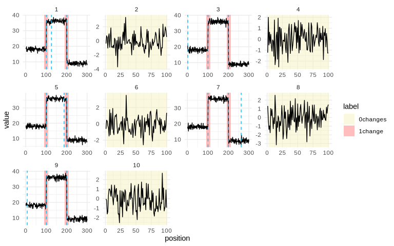

<!-- README.md is generated from README.Rmd. Please edit that file -->

# mlr3changepoint

Package website:
[sleepysnorlax05.github.io/mlr3changepoint](https://sleepysnorlax05.github.io/mlr3changepoint/)

Weakly supervised changepoint detection for
**[mlr3](https://mlr3.mlr-org.com)**.

<!-- badges: start -->

[](https://github.com/sleepysnorlax05/mlr3changepoint/actions/workflows/R-CMD-check.yaml)
[](https://app.codecov.io/github/sleepysnorlax05/mlr3changepoint)
[](https://lifecycle.r-lib.org/articles/stages.html#experimental)
[](https://sleepysnorlax05.github.io/mlr3changepoint/)
<!-- badges: end -->

*mlr3changepoint* is the changepoint detection package of the
[mlr3](https://mlr-org.com) ecosystem. A changepoint or peak model needs
a penalty that sets how many changes it keeps. The package learns that
penalty for each sequence from labelled examples, as a function of
features of the sequence. Its tasks, learners, predictions and measures
work with `resample()`, `benchmark()`,
[mlr3tuning](https://mlr3tuning.mlr-org.com) and
[mlr3pipelines](https://mlr3pipelines.mlr-org.com).

The supervision is weak. Each label covers a region of a sequence and
says how many changes it holds, for example `1change` on positions 90 to
110 or `0changes` on a flat stretch. A label does not give the position
of a change or a value for each point. Changepoint labels follow
[penaltyLearning](https://cran.r-project.org/package=penaltyLearning),
and peak labels follow
[PeakError](https://cran.r-project.org/package=PeakError).

The package is developed during Google Summer of Code 2026, and its API
may still change.

## Feature overview

- A `"changepoint"` task type, `TaskCpt`, holding one labelled sequence
  per row with `"changepoint"` or `"peak"` labels.
- Four learners that predict a `log(lambda)` penalty per sequence from
  its features: linear interval regression, gradient boosted trees, and
  max margin interval trees and forests.
- A featureless baseline that learns one constant penalty, for checking
  that the features help in `benchmark()`.
- Three measures that decode the segmentation each penalty selects and
  score it against the labels.
- `autoplot()` methods that draw the labelled sequences, the predicted
  changes and the ROC curve.

## Resources

The [package
website](https://sleepysnorlax05.github.io/mlr3changepoint/) has a
chapter on each part of the package and case studies on real and
simulated data.

- Start with [Getting
  started](https://sleepysnorlax05.github.io/mlr3changepoint/articles/getting-started.html)
  for a first workflow from task to score.
- Learn how [tasks and
  labels](https://sleepysnorlax05.github.io/mlr3changepoint/articles/tasks.html)
  describe sequences and labelled regions.
- Compare the
  [learners](https://sleepysnorlax05.github.io/mlr3changepoint/articles/learners.html)
  and their hyperparameters.
- Score and plot predictions in [evaluation and
  plots](https://sleepysnorlax05.github.io/mlr3changepoint/articles/evaluation.html).
- Follow the case studies on [neuroblastoma copy-number
  profiles](https://sleepysnorlax05.github.io/mlr3changepoint/articles/case-study-neuroblastoma.html),
  [peak detection in count
  data](https://sleepysnorlax05.github.io/mlr3changepoint/articles/case-study-peaks.html)
  and a [learner
  benchmark](https://sleepysnorlax05.github.io/mlr3changepoint/articles/case-study-benchmark.html).

## Installation

Install the development version from GitHub:

``` r
# install.packages("pak")
pak::pak("sleepysnorlax05/mlr3changepoint", dependencies = TRUE)
```

`dependencies = TRUE` also installs the solvers and regressors the
learners use. The MMIT and MMIF learners need the mmit package, which is
not on CRAN. Its upstream sources no longer compile on macOS and
Windows, so pak installs a patched copy from
`sleepysnorlax05/mmit/Rpackage`.

## Learners

| Key | Label | Packages |
|----|----|----|
| [changepoint.intregrcv](https://sleepysnorlax05.github.io/mlr3changepoint/reference/mlr_learners_changepoint.intregrcv.html) | Cross-Validated Interval Regression | [penaltyLearning](https://cran.r-project.org/package=penaltyLearning) |
| [changepoint.xgboost.aft](https://sleepysnorlax05.github.io/mlr3changepoint/reference/mlr_learners_changepoint.xgboost.aft.html) | Extreme Gradient Boosting AFT | [xgboost](https://cran.r-project.org/package=xgboost) |
| [changepoint.mmit](https://sleepysnorlax05.github.io/mlr3changepoint/reference/mlr_learners_changepoint.mmit.html) | Max Margin Interval Tree | [mmit](https://github.com/aldro61/mmit) |
| [changepoint.mmif](https://sleepysnorlax05.github.io/mlr3changepoint/reference/mlr_learners_changepoint.mmif.html) | Max Margin Interval Forest | [mmit](https://github.com/aldro61/mmit), [future.apply](https://cran.r-project.org/package=future.apply) |
| [changepoint.featureless](https://sleepysnorlax05.github.io/mlr3changepoint/reference/mlr_learners_changepoint.featureless.html) | Featureless Constant Penalty | [penaltyLearning](https://cran.r-project.org/package=penaltyLearning) |

Every learner also needs
[penaltyLearning](https://cran.r-project.org/package=penaltyLearning)
and computes its model paths with
[changepoint](https://cran.r-project.org/package=changepoint) for
`"changepoint"` labels or
[PeakSegOptimal](https://cran.r-project.org/package=PeakSegOptimal) and
[PeakError](https://cran.r-project.org/package=PeakError) for `"peak"`
labels.

## Measures

| Key | Label | What it scores |
|----|----|----|
| [changepoint.label_error](https://sleepysnorlax05.github.io/mlr3changepoint/reference/mlr_measures_changepoint.label_error.html) | Label Error | Share of labelled regions with a false positive or false negative |
| [changepoint.label_accuracy](https://sleepysnorlax05.github.io/mlr3changepoint/reference/mlr_measures_changepoint.label_accuracy.html) | Label Accuracy | One minus the label error |
| [changepoint.auc](https://sleepysnorlax05.github.io/mlr3changepoint/reference/mlr_measures_changepoint.auc.html) | Area Under the ROC Curve | Area under the ROC curve traced by shifting all predicted penalties |

## Example

We simulate ten toy sequences. Odd ones change mean twice and carry a
`1change` label around each change. Even ones are flat and carry a
`0changes` label.

``` r
library(mlr3)
library(mlr3changepoint)
library(data.table)

set.seed(36)
signal = vector("list", 10L)
label = vector("list", 10L)
for (i in seq_len(10L)) {
  if (i %% 2L == 1L) {
    signal[[i]] = c(rnorm(100, 18), rnorm(100, 36), rnorm(100, 9))
    label[[i]] = data.table(start = c(90, 190), end = c(110, 210), label = "1change")
  } else {
    signal[[i]] = rnorm(100, 0)
    label[[i]] = data.table(start = 1, end = 100, label = "0changes")
  }
}
```

`TaskCpt` stores one sequence and its labels per row.

``` r
task = TaskCpt$new(
  id = "toy", backend = data.table(signal = signal, label = label),
  target = "label", sequence = "signal", label_type = "changepoint"
)
```

We train the interval regression learner and predict a `log(lambda)` for
each sequence.

``` r
learner = lrn("changepoint.intregrcv", Kmax = 3L, n.folds = 2L, min.observations = 2L)
learner$train(task)
prediction = learner$predict(task)
```

The measures decode the segmentation each penalty selects and score it
against the labels.

``` r
prediction$score(msrs(c("changepoint.label_error", "changepoint.auc")), task = task)
#> changepoint.label_error         changepoint.auc 
#>                       0                       1
```

`autoplot()` draws each sequence with its labelled regions and dashed
lines at the predicted changes.

``` r
ggplot2::autoplot(prediction, task = task)
```



## Bugs, questions, feedback

*mlr3changepoint* is free and open source software, and feedback is
welcome. Report bugs, ask questions or suggest features in the [issue
tracker](https://github.com/sleepysnorlax05/mlr3changepoint/issues). A
minimal reproducible example made with
[reprex](https://reprex.tidyverse.org/) makes a bug much easier to fix.

## Related work

- [penaltyLearning](https://cran.r-project.org/package=penaltyLearning):
  supervised penalty learning for changepoint detection, and the source
  of the labelled-region setup used here.
- [changepoint](https://cran.r-project.org/package=changepoint):
  classical changepoint methods. Its SegNeigh solver computes the
  changepoint model paths.
- [PeakSegOptimal](https://cran.r-project.org/package=PeakSegOptimal)
  and [PeakError](https://cran.r-project.org/package=PeakError): optimal
  peak models and peak label errors, used for `"peak"` labels.
- [mmit](https://github.com/aldro61/mmit): maximum margin interval trees
  and forests.
- [rupturesRcpp](https://cran.r-project.org/package=rupturesRcpp),
  [binsegRcpp](https://cran.r-project.org/package=binsegRcpp),
  [fpop](https://cran.r-project.org/package=fpop) and
  [dust](https://github.com/vrunge/dust): fast unsupervised
  segmentation.

## Acknowledgements

*mlr3changepoint* is developed during [Google Summer of Code
2026](https://summerofcode.withgoogle.com/) for the [R Project for
Statistical Computing](https://www.r-project.org/). Thanks to the
mentors Toby Hocking, Marc Becker and Tung Lam Nguyen, and to the
[mlr-org](https://github.com/mlr-org) team for the mlr3 ecosystem this
package extends.
